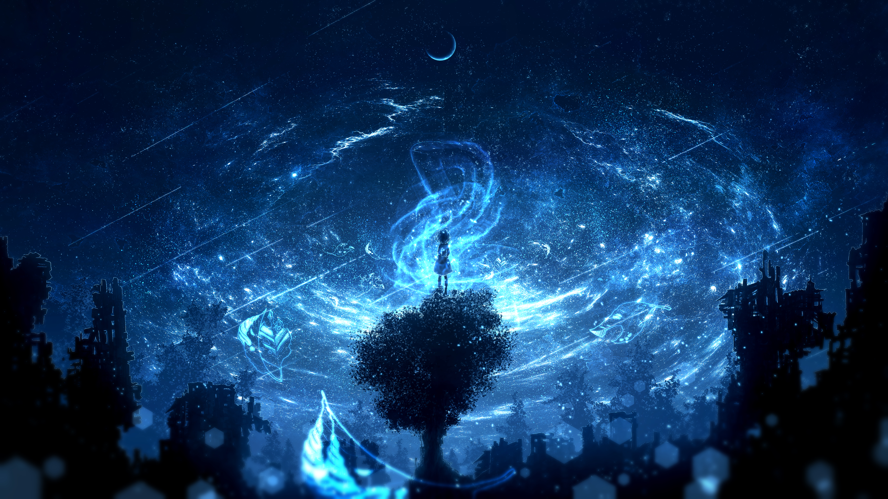

# 🌌 Vencord Starlight Theme

> A vibrant cosmic Discord theme for [Vencord](https://vencord.dev/) — deep space aesthetics with vivid colors, dark vignette overlay, and zero blur.



---

## ✨ Features

- 🎨 **Starlight Cosmic palette** — Sky blue (#38bdf8) & teal (#5eead4) accent colors
- 🌌 **4K space background** with a smart **dark vignette overlay** (center dimmed, edges vivid)
- 🔭 **Zero blur** — crisp, sharp background at 100% quality
- 💬 **Readable text** — text shadows ensure legibility on bright nebula regions
- ✨ **Glowing unread server animation** (starlightPulse)
- 🖱️ Styled message box with focus glow, thin separators, and reaction highlights

---

## 📦 Installation

### Method 1 — Vencord Online Themes (Recommended)

1. Open **Discord** → **User Settings** → **Vencord** → **Themes**
2. Click **Online Themes** and paste the following URL:

```
https://raw.githubusercontent.com/tungcorn/vencord-starlight-theme/main/starlight.theme.css
```

> ⚠️ Replace `tungcorn` with your actual GitHub username after pushing.

### Method 2 — Local Theme File

1. Download [`starlight.theme.css`](starlight.theme.css)
2. Place it in your Vencord themes folder:
   - **Windows:** `%AppData%\Vencord\themes\`
3. Enable it in **User Settings → Vencord → Themes**

---

## 🖼️ Background Image

The default background is hosted in this repo at [`assets/background.jpg`](assets/background.jpg).

To use your **own background**, edit the `:root` section in `starlight.theme.css`:

```css
:root {
  --theme-background-image: url(YOUR_IMAGE_URL_HERE);
}
```

---

## 🎨 Customization

| Variable | Default | Description |
|---|---|---|
| `--theme-background-image` | GitHub raw URL | Background wallpaper |
| `--main-theme-color` | `#38bdf8` | Primary accent color |
| `--category-hover-color` | `#5eead4` | Hover highlight color |
| `--message-box-transparency` | `rgba(10,15,30,0.45)` | Chat input opacity |
| `--server-listing-width` | `126px` | Server sidebar width |

---

## 🔧 Dark Overlay Adjustment

The vignette dims the center to reduce eye strain. Edit the `::before` block to adjust:

```css
#app-mount::before {
  background: radial-gradient(
    ellipse at center,
    rgba(0, 0, 0, 0.42) 0%,   /* Center darkness */
    rgba(0, 0, 0, 0.00) 100%  /* Edges: transparent */
  );
}
```


---

## 🛠️ Troubleshooting

### ❌ Background is completely black

This is the most common issue. It happens when Discord cannot load the background image URL.

**Cause 1 — Using 
aw.githubusercontent.com links**

GitHub raw URLs serve files as 	ext/plain, not image/jpeg, so Discord/Electron will reject them and show a black background.

✅ **Fix:** Use a direct-link image host instead. Recommended options:
- [catbox.moe](https://catbox.moe) — free, no account needed, permanent links
- [imgbb.com](https://imgbb.com) — free with account
- [postimages.org](https://postimages.org)

Upload your image there and paste the **direct link** (ending in .jpg / .png) into --theme-background-image.

**Cause 2 — Local file paths (C:\Users\...)**

Electron/Chromium blocks access to local filesystem paths in CSS for security reasons.

✅ **Fix:** Upload the image to any online host (see above) and use the HTTPS URL.

**Cause 3 — Expired Discord CDN links**

Discord attachment URLs (cdn.discordapp.com/attachments/...) expire after a few days.

✅ **Fix:** Re-upload the image to a permanent host like catbox.moe.

---

### ❌ Background loads but bottom half is black / cut off

✅ **Fix:** Make sure these rules are present in your CSS:

```css
body,
#app-mount {
  background-attachment: fixed !important;
  background-size: cover !important;
}
```

---

### ❌ Background image is too bright / hard to read text

✅ **Fix:** Increase the dark overlay intensity in the ::before block:

```css
#app-mount::before {
  background: radial-gradient(
    ellipse at center,
    rgba(0, 0, 0, 0.55) 0%,   /* ← Increase this value (0.0–1.0) */
    rgba(0, 0, 0, 0.30) 45%,
    rgba(0, 0, 0, 0.10) 75%,
    rgba(0, 0, 0, 0.00) 100%
  );
}
```

---

## 📋 Requirements

- [Vencord](https://vencord.dev/) installed on Discord

## 📄 License

MIT — feel free to fork, modify, and share.

---

*Based on [NotAnotherAnimeTheme](https://github.com/puckzxz/NotAnotherAnimeTheme) by puckzxz.*
